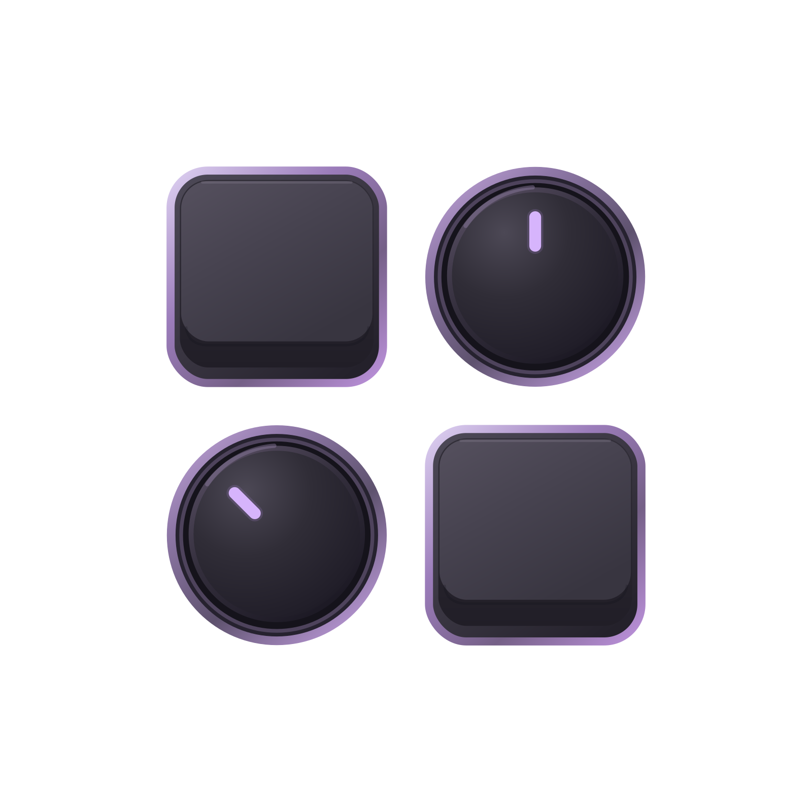

<p align="center">
  
</p>

<h1 align="center">Meu Keymap</h1>

<p align="center">Configure seu macropad no Windows com perfis, atalhos e automações que reagem ao que você faz.</p>

<p align="center">
  <a href="#recursos">Recursos</a> ·
  <a href="#instalação">Instalação</a> ·
  <a href="#modos-de-execução">Modos de execução</a> ·
  <a href="docs/guia.md">Guia de uso</a>
</p>

<p align="center">
  
  
  <a href="LICENSE"></a>
</p>

## Sobre o projeto

O Meu Keymap é um configurador local para o **K8850 de 16 teclas e 3 encoders, protocolo 11**. Cada encoder aceita giro nos dois sentidos e clique. São **75 posições configuráveis** nas três camadas. A interface abre no navegador, e o motor de automações roda no Windows.

## Recursos

- **Perfis e camadas.** Crie, duplique, importe e exporte perfis em JSON. Dê nomes e ícones aos controles.
- **Ações e gestos.** Configure atalhos, comandos de mídia, sequências, digitação de texto e scripts. Uma tecla pode fazer coisas diferentes ao clicar, clicar duas vezes, pressionar, segurar ou soltar.
- **Atalhos mantidos.** Mantenha uma combinação pressionada pelo tempo em que segurar a tecla. Para ditado, o macropad pode acionar o atalho do seu aplicativo e silenciar as saídas de áudio do Windows durante a fala. Ao soltar, o som volta ao estado anterior.
- **Regras e eventos.** Combine condições sobre teclas, estados personalizados, processos do Windows, microfone e fontes do OBS. Uma mesma tecla pode ter uma ação durante uma gravação e outra fora dela.
- **LEDs estáticos.** Escolha a cor das teclas por camada e confira as configurações gravadas. O mapa de teclas e as cores têm controles próprios.
- **Execução em segundo plano.** Use a bandeja do Windows para abrir a interface. As automações continuam após fechar a aba. A inicialização automática pode retomar o último perfil aplicado depois de conferir o macropad.
- **Leitura e recuperação.** Leia o mapa atual sem apertar cada controle, teste as regras no simulador e recupere os atalhos anteriores com o backup.

## Instalação

Requer **Windows x64**, **Git** e **Node.js 24 ou superior**. Execute os comandos abaixo no PowerShell.

```powershell
git clone https://github.com/patrick-siotti/meu-keymap.git
cd meu-keymap
npm ci
npm run build
.\desktop\install-desktop.ps1
.\iniciar.ps1
```

Depois da primeira instalação, use o atalho **Meu Keymap** da Área de Trabalho ou o ícone da bandeja. A interface local abre em [127.0.0.1:4173](http://127.0.0.1:4173/).

## Uso

1. Conecte o macropad por USB e escolha **Conectar macropad → Mapear por código** para ler a configuração atual.
2. Abra **Teclas**, escolha uma camada e selecione uma tecla ou um canal de encoder. Configure o gatilho e a ação.
3. Selecione o modo de execução e clique em **Salvar e aplicar**. A aba **Execução** mostra o que está aplicado e se o motor está ativo.

O [guia de uso](docs/guia.md) mostra como configurar [ditado com mudo temporário](docs/guia.md#ditado-com-mudo-temporário), regras, OBS, LEDs e inicialização com o Windows.

## Modos de execução

| Modo | Onde as ações rodam |
| --- | --- |
| **Direto no aparelho** | Atalhos compatíveis, mídia e macros gravados no macropad funcionam com o aplicativo fechado. |
| **Misto** | Atalhos compatíveis rodam no macropad. Texto, scripts, regras e outras automações usam o motor do Windows. |
| **Automações no Windows** | O motor do Windows executa as ações do perfil inteiro. Use este modo para executar uma ação ao ativar uma camada ou trocar a camada lógica por uma regra. |

Pressionar, segurar e soltar estão disponíveis nos modos com motor Windows para até **cinco posições de tecla** somadas nas três camadas. Veja o [guia](docs/guia.md#gatilhos-e-condições) para os limites dos gestos e do modo direto.

## Desenvolvimento

```powershell
npm ci
npm run dev
npm test
npm run build
```

## Licença

[MIT](LICENSE) · Patrick G. Siotti
